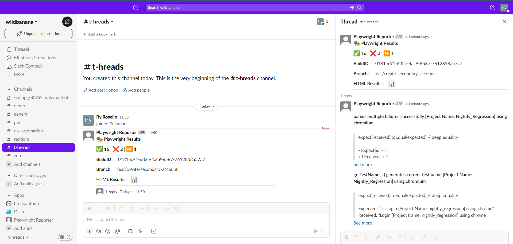

Start with [Getting started](./getting-started.md) and configure either a [webhook](./webhooks.md) or a [bot](./slack-bot.md). This page describes options for the Playwright reporter. The [CLI](./cli.md) uses a separate JSON configuration and different names for some options.

## Configuration example

This advanced bot configuration adds routing destinations, a custom layout, metadata, and threaded details. Define the named `generateCustomLayout` export using the [custom layout guide](./custom-layouts.md).

```typescript
  import { generateCustomLayout } from "./my_custom_layout";
  import { LogLevel } from '@slack/web-api';
  ...

  reporter: [
    [
      "./node_modules/playwright-slack-report/dist/src/SlackReporter.js",
      {
        channels: ["pw-tests", "ci"], // provide one or more Slack channels
        sendResults: "always", // "always", "on-failure", "on-flaky", "off"
        layout: generateCustomLayout,
        maxNumberOfFailuresToShow: 4,
        meta: [
            {
                key: 'BUILD_NUMBER',
                value: '323332-2341',
            },
            {
                key: 'WHATEVER_ENV_VARIABLE',
                value: process.env.SOME_ENV_VARIABLE, // depending on your CI environment, this can be the branch name, build id, etc
            },
            {
                key: 'HTML Results',
                value: '<https://your-build-artifacts.my.company.dev/pw/23887/playwright-report/index.html|📊>',
            },
        ],
        slackOAuthToken: process.env.SLACK_BOT_USER_OAUTH_TOKEN,
        slackLogLevel: LogLevel.DEBUG,
        disableUnfurl: true,
        showInThread: true,
      },

    ],
  ],
```

## Options

### **channels**

An array of Slack channel names or IDs for bot delivery. Provide at least one destination for each enabled outcome, either through `channels` or the outcome-specific arrays below. Webhooks use the channel selected when their URL was created.

### **onSuccessChannels**

(Optional, bot only) An array of Slack channels to post to when the run is successful, including flaky-only runs. Value from `channels` is used if not defined here.

### **onFailureChannels**

(Optional, bot only) An array of Slack channels to post to when tests have failed, global errors occurred, or the run timed out or was interrupted. Value from `channels` is used if not defined here.

### **sendResults**

Can be _"always"_, _"on-failure"_, _"on-flaky"_ or _"off"_:

- **always** - will send the results to Slack at completion of the test run
- **on-failure** - sends results for failed tests, global errors, run timeouts, and graceful interruptions. Flaky-only runs are skipped.
- **on-flaky** - sends only when Playwright reports at least one flaky test, including tests that pass on retry. Runs with failures but no flaky tests are skipped. Mixed runs with both failures and flaky tests are sent.
- **off** - turns off the reporter, it will not send the results to Slack

Flaky-only runs use `onSuccessChannels`; runs with flaky tests and a test or run-level failure use `onFailureChannels`. Both fall back to `channels` as usual. `on-failure` continues to skip flaky-only runs.

### **layout**

An optional function that receives `SummaryResults` and returns an array of Slack blocks. See [Custom message layouts](./custom-layouts.md) for the signature, summary fields, and examples. Supply additional context through the `meta` option below.

### **layoutAsync**

Same as **layout** above, but asynchronous in that it returns a promise.

### **maxNumberOfFailuresToShow**

Limits the combined number of global errors and test failures shown in the Slack message, defaults to 10. Global errors are shown first. Set to `0` to hide details; the overall unsuccessful run status remains visible. The CLI uses `maxNumberOfFailures` for the same limit, with a default of 5.

### **maxNumberOfFlakyTestsToShow**

Limits the flaky test details shown by the default layout, defaults to 10. Must be a non-negative integer. Set to `0` to hide the details while keeping the flaky count and notification behavior.

Each flaky entry includes the suite, test name, project, and actual retries performed (excluding the initial attempt). It is reported once per test/project/repetition, rather than once per failed attempt. Flaky details have their own limit, independent of `maxNumberOfFailuresToShow`.

```typescript
{
  channels: ['qa'],
  sendResults: 'on-flaky',
  maxNumberOfFlakyTestsToShow: 5,
  showInThread: true,
}
```

Custom layouts receive `summaryResults.flakyTests`, an optional array of `{ suite, test, projectName, file, retries }`. Layout callbacks control how these details appear; the default layout's display limit does not trim the array passed to callbacks.

### **slackOAuthToken**

Instead of providing an environment variable `SLACK_BOT_USER_OAUTH_TOKEN` you can specify the token in the config in the `slackOAuthToken` field.

### **slackLogLevel** (default LogLevel.DEBUG)

This option allows you to control slack client severity levels for log entries. It accepts a value from @slack/web-api `LogLevel` enum:

- ERROR
- WARN
- INFO
- DEBUG

Import `LogLevel` from `@slack/web-api` and set `slackLogLevel: LogLevel.ERROR` to log only errors. The corresponding string value is lowercase (`'error'`); CLI JSON uses these lowercase values.

### **disableUnfurl** (default: false)

Enable or disable unfurling of links in Slack messages.

### **showInThread** (default: false)

Instructs the reporter to show failure, global error, and flaky test details in a thread instead of the main channel. The summary counts and unsuccessful run status remain in the parent message. This is bot-only: leave it `false` for webhooks, which show details inline.



### **sendCustomBlocksInThreadAfterIndex** (default: undefined)

Instructs the reporter to send blocks provided by your [custom layout](./custom-layouts.md) to a thread following the index specified. _Example_:

`sendCustomBlocksInThreadAfterIndex: 3`

This option applies to bot delivery; webhooks do not support this reporter's thread splitting.

### **proxy** (optional)

String representation of your proxy server.
_Example_:

`proxy: "http://proxy.mycompany.com:8080",`

### **meta** (default: empty array)

The meta data to be sent to Slack. This is useful for providing additional context to your test run.

**Examples:**

```typescript
...
meta: [
  {
    key: 'Suite',
    value: 'Nightly full regression',
  },
  {
    key: 'GITHUB_REPOSITORY',
    value: 'octocat/telsa-ui',
  },
  {
    key: 'GITHUB_REF',
    value: process.env.GITHUB_REF,
  },
],
...
```

## Run-level errors and interruptions

The reporter captures Playwright's global `onError` events and the final run
status from `onEnd`. Setup/teardown errors, worker errors, global timeouts, and
gracefully interrupted runs can therefore notify Slack even when the failed-test
count is zero. An actual Playwright "No tests found" error also sends a failure
notification; a clean empty run without errors stays silent.

The default layout shows an unsuccessful run status above the details. Global
errors are separate from test failures, so they do not inflate test counts.
With `showInThread: true`, bot reports put both kinds of error details in the
report's thread while retaining the run status in the parent. Webhook reports
show the details inline with `showInThread` left `false`.

Custom layouts receive these optional `SummaryResults` fields:

| Field | Meaning |
| --- | --- |
| `runStatus` | `passed`, `failed`, `timedout`, or `interrupted` |
| `runErrors` | Global error strings with ANSI formatting removed; absent when there are none |

Use both fields when deciding whether a custom layout should display success;
`failed === 0` alone does not imply that the whole run succeeded. Existing custom
layouts retain control of their output and must render these fields themselves.
See the [summary fields and success check](./custom-layouts.md#summary-results) for examples.
Notifications require Playwright to reach the reporter's completion callback;
forced termination, `SIGKILL`, or loss of the CI machine can prevent delivery.
