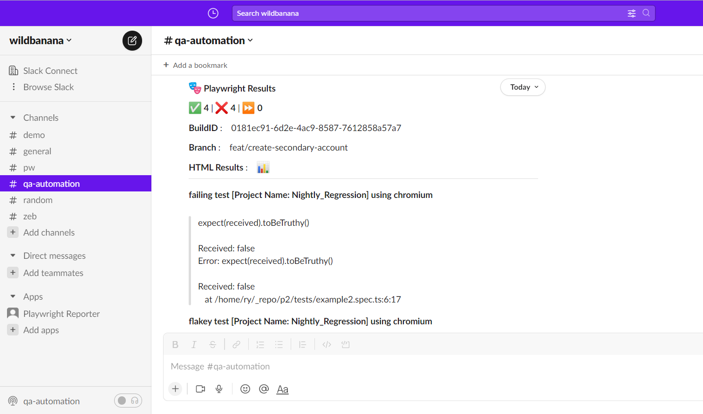

New to the package? The [overview](./overview.md) explains its features and the reporter and CLI workflows. This guide sets up a reporter that sends a message when your Playwright run finishes.

## Prerequisites

- A working Playwright Test project with `@playwright/test`, its required browsers, and a test suite you can run with `npx playwright test`.
- A Node.js version compatible with your installed Playwright and this package's dependencies. The packaged consumer harness checks Node 24 and newer; Node 24+ is a suitable starting point for the current package.
- npm or Yarn to install the reporter. Consumers can keep their existing Node/npm/Yarn workflow; Bun is used for [contributing to this repository](./contributing.md).
- A Slack workspace and permission to create or install an app. Your workspace may require administrator approval.
- A destination channel and network access to Slack from your local machine or CI runner. See [proxy configuration](./configuration.md#proxy-optional) if your network requires a proxy.

## Install

Run one of these commands in your Playwright project's directory:

**yarn**

`yarn add playwright-slack-report -D`

**npm**

`npm install playwright-slack-report -D`

## Choose your Slack connection

Compare [features by mode](./feature-comparison.md) to choose between webhook and bot delivery with the reporter or CLI.

- [Incoming webhook](./webhooks.md): the shortest path to a report in one channel. Failure, global error, and flaky details appear inline.
- [Slack bot](./slack-bot.md): send to multiple channels, route successful and unsuccessful runs separately, and put details in a thread.

Follow the relevant guide to create your credentials. Configure one transport and keep credentials in environment variables or CI secrets. For a webhook, do not also set `SLACK_BOT_USER_OAUTH_TOKEN` or `slackOAuthToken`.

## Send your first report

Create an [incoming webhook](./webhooks.md) and set `SLACK_WEBHOOK_URL` in your environment. Add the reporter to `playwright.config.ts`:

```typescript
import { defineConfig } from '@playwright/test';

export default defineConfig({
  reporter: [
    [
      './node_modules/playwright-slack-report/dist/src/SlackReporter.js',
      {
        slackWebHookUrl: process.env.SLACK_WEBHOOK_URL,
        sendResults: 'always', // Also: 'on-failure', 'on-flaky', 'off'
      },
    ],
    ['dot'], // other reporters
  ],
});
```

Set the webhook URL in the same shell where you run Playwright, replacing the placeholder with your URL. In CI, inject `SLACK_WEBHOOK_URL` from your secret store instead.

**Bash / zsh**

```sh
export SLACK_WEBHOOK_URL='https://hooks.slack.com/services/YOUR/WEBHOOK/SECRET'
npx playwright test
```

**PowerShell**

```powershell
$env:SLACK_WEBHOOK_URL = 'https://hooks.slack.com/services/YOUR/WEBHOOK/SECRET'
npx playwright test
```

The reporter posts a summary to your webhook's Slack channel when the run finishes. Your terminal still shows the `dot` reporter. With a bot, use the complete configuration and token instructions in [Slack bot setup](./slack-bot.md).

If no report arrives, check the terminal for configuration or delivery errors, confirm your credentials are set, and check the selected channel. A clean empty run stays silent; see [run-level errors and interruptions](./configuration.md#run-level-errors-and-interruptions) for failure cases and delivery limits.

## What you can build

Send reports to one or more channels, publish only when tests fail or become flaky, include branch and build context, and define your own Slack message layout.



## Next steps

- [Configuration](./configuration.md): notification rules, channel routing, failure and flaky details, logging, proxies, and metadata.
- [CLI and sharded runs](./cli.md): send existing JSON results or a merged report from CI.
- [Custom message layouts](./custom-layouts.md): change Slack blocks and add screenshots or videos.
