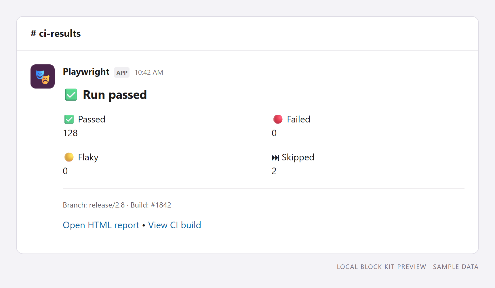
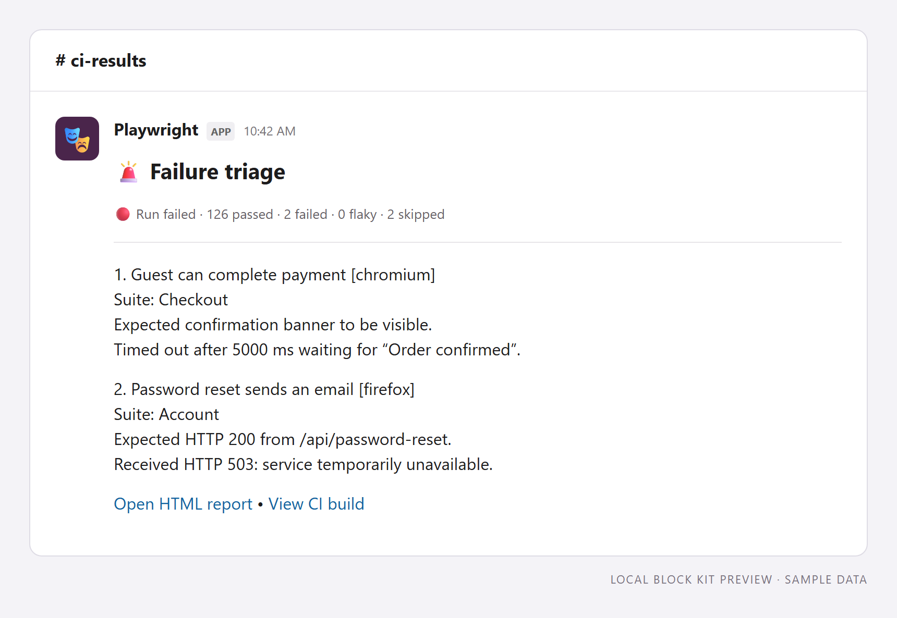
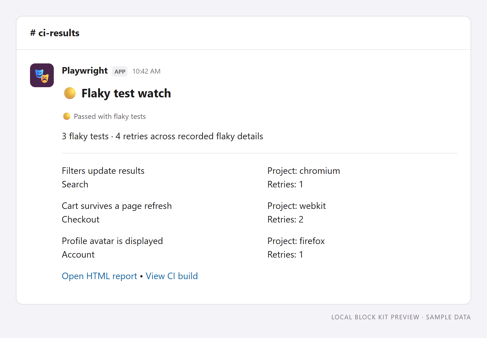
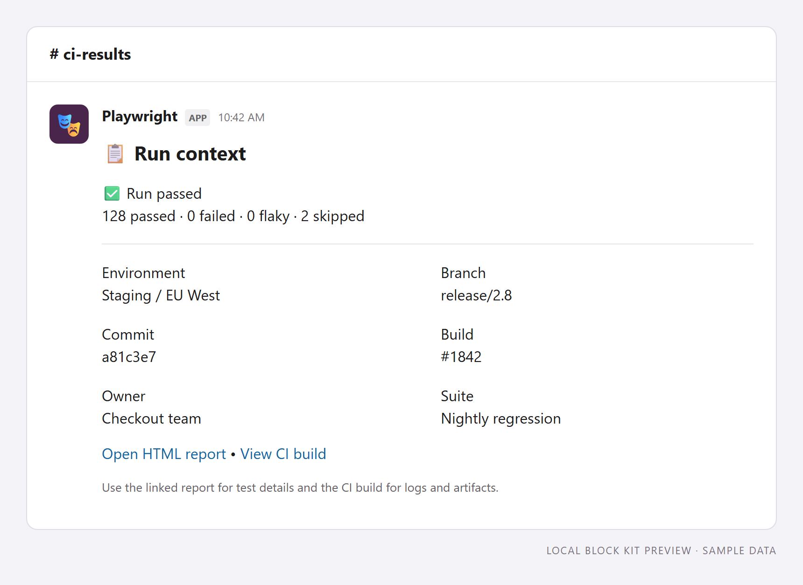
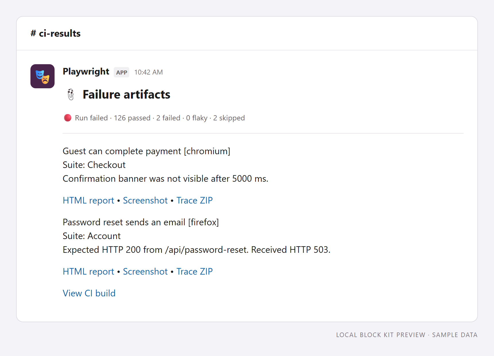

Start with one of these five layouts and adapt it to your team's Slack channel. Each is a synchronous function that receives `SummaryResults` and returns Slack blocks. They work with reporter webhook and bot delivery.

The screenshots below are **local previews rendered from the examples' actual Block Kit output using sample data**. They illustrate the content and arrangement; Slack's fonts and spacing may differ. No Slack messages are sent when generating these previews.

## 1. Build summary

**Function:** `generateBuildSummary` · **Best for:** a busy CI channel.

Four fields put passed, failed, flaky, and skipped counts first. Branch and build context sit below the counts, followed by links to the report and CI run. The heading reflects run failures, timeouts, and interruptions, even when no individual test failed.



[Download Block Kit JSON](pathname:///playwright-slack-report/examples/layouts/build-summary.json)

## 2. Failure triage

**Function:** `generateFailureTriage` · **Best for:** investigating a broken build.

Show up to two global run errors and three test failures, including the test, suite, and a shortened error message. An omission count points readers to the full report when more details are available. A run failure with no recorded details still keeps its failed status visible.



[Download Block Kit JSON](pathname:///playwright-slack-report/examples/layouts/failure-triage.json)

## 3. Flaky test watch

**Function:** `generateFlakyWatch` · **Best for:** a test reliability channel.

List up to four flaky tests with suite, project, and actual retry counts. This uses `flakyTests` rather than guessing from failures or configured retry limits. Use `sendResults: 'on-flaky'` if you only want notifications for runs containing flaky tests. The overall run status remains visible for runs that also have failures.



[Download Block Kit JSON](pathname:///playwright-slack-report/examples/layouts/flaky-watch.json)

## 4. Run context

**Function:** `generateRunContext` · **Best for:** sharing a run with another team.

Combine the outcome and counts with environment, branch, commit, build, owner, and suite. Report and CI links help teammates find the right artifacts without searching the channel. Missing metadata displays as “Not supplied”.



[Download Block Kit JSON](pathname:///playwright-slack-report/examples/layouts/run-context.json)

## 5. Failure artifacts

**Function:** `generateFailureArtifacts` · **Best for:** opening debugging artifacts directly from a failure notification.

Each failure has a short error summary and up to three hosted links: HTML report, screenshot, and trace ZIP.
The template reads `failures[].artifacts`, which the reporter or CLI populates through `artifactLinks`.
It shows up to three test failures and two global errors. Additional details and oversized links have omission notices.
Failures without links remain visible. Invalid URLs and duplicate URLs are omitted.



[Download Block Kit JSON](pathname:///playwright-slack-report/examples/layouts/failure-artifacts.json) · [Download TypeScript template](pathname:///playwright-slack-report/examples/layouts/showcase.ts)

This template requires the `artifactLinks` feature described in [Unreleased notes](./release-notes.md#unreleased).
The sample URLs are placeholders. The package does not upload files or grant access to hosted artifacts.
Trace links open ZIP files. The HTML link opens the configured report page.

### Reporter setup

1. Download `showcase.ts` from the link above.
2. Save it beside `playwright.config.ts`.
3. Install `@slack/types` as a development dependency.
4. Set `SLACK_WEBHOOK_URL` to your incoming webhook URL.
5. Replace the example URLs with your artifact host URLs.
6. Set `pathPrefix` to the local directory mirrored at `baseUrl`.

```typescript
import { defineConfig } from '@playwright/test';
import { generateFailureArtifacts } from './showcase';

export default defineConfig({
  outputDir: 'test-results',
  use: {
    screenshot: 'only-on-failure',
    trace: 'retain-on-failure',
  },
  reporter: [
    ['dot'],
    ['html', { open: 'never' }],
    ['playwright-slack-report/dist/src/SlackReporter.js', {
      slackWebHookUrl: process.env.SLACK_WEBHOOK_URL,
      sendResults: 'on-failure',
      layout: generateFailureArtifacts,
      disableUnfurl: true,
      artifactLinks: {
        baseUrl: 'https://example.com/artifacts/1842/',
        pathPrefix: 'test-results',
        reportUrl: 'https://example.com/reports/1842/index.html',
      },
    }],
  ],
});
```

Upload `test-results` and `playwright-report` to the configured destinations with their directory structures intact.
The reporter sends links when the test run ends. Those links become usable after your upload finishes.
If uploads must finish before notification, use the CLI workflow below.

For bot delivery, replace `slackWebHookUrl` with `channels: ['ci-results']`.
Set `SLACK_BOT_USER_OAUTH_TOKEN` to the bot token.
This custom layout puts links inline. Keep `showInThread` off for the pictured result.
For default failure threads, omit `layout` and enable `showInThread` with bot delivery.

### CLI setup

1. Generate Playwright JSON with the JSON reporter.
2. Upload the artifacts and HTML report before sending the notification.
3. Compile the downloaded template with the command below.

```sh
bun build ./showcase.ts --target=node --format=cjs --outfile=./showcase.cjs
```

4. Save this configuration as `cli-artifacts.json`.
5. Replace the example URLs and channel name with your values.
6. Set `pathPrefix` to the directory represented in the JSON attachment paths.
7. Set `SLACK_BOT_USER_OAUTH_TOKEN` to the bot token.

```json
{
  "sendResults": "on-failure",
  "slackLogLevel": "error",
  "sendUsingBot": { "channels": ["ci-results"] },
  "disableUnfurl": true,
  "customLayout": {
    "source": "./showcase.cjs",
    "functionName": "generateFailureArtifacts"
  },
  "artifactLinks": {
    "baseUrl": "https://example.com/artifacts/1842/",
    "pathPrefix": "test-results",
    "reportUrl": "https://example.com/reports/1842/index.html"
  }
}
```

8. Send the report after the uploads finish.

```sh
bunx playwright-slack-report -c cli-artifacts.json -j results.json
```

Relative paths resolve from the CLI working directory.
For JSON from another machine, use its absolute upload directory as `pathPrefix`.
See [artifact mapping options](./configuration.md#artifactlinks) for path rules and [CLI configuration](./cli.md#hosted-artifact-links) for transport options.

## Use an example

[Download showcase.ts](pathname:///playwright-slack-report/examples/layouts/showcase.ts) and save it in your project. The file contains all five functions and their shared helpers. Install `@slack/types` as a development dependency if needed, then select a function in `playwright.config.ts`:

```typescript
import { defineConfig } from '@playwright/test';
import { generateBuildSummary } from './showcase';

export default defineConfig({
  reporter: [
    ['dot'],
    ['playwright-slack-report/dist/src/SlackReporter.js', {
      slackWebHookUrl: process.env.SLACK_WEBHOOK_URL,
      sendResults: 'always',
      layout: generateBuildSummary,
      meta: [
        { key: 'Environment', value: 'Staging / EU West' },
        { key: 'Branch', value: process.env.GITHUB_REF_NAME || 'local' },
        { key: 'Build', value: process.env.GITHUB_RUN_NUMBER || 'local' },
        { key: 'Commit', value: process.env.GITHUB_SHA || 'local' },
        { key: 'Owner', value: 'Checkout team' },
        { key: 'Suite', value: 'Nightly regression' },
        { key: 'Report URL', value: 'https://example.com/reports/1842' },
        { key: 'Build URL', value: 'https://example.com/builds/1842' },
      ],
    }],
  ],
});
```

Replace the example URLs with your own report and CI links. Optional links are omitted if they are missing or invalid. Metadata keys are case-sensitive. For bot delivery, replace `slackWebHookUrl` with `channels: ['ci-results']` and supply `SLACK_BOT_USER_OAUTH_TOKEN`.

These custom layouts show details inline and impose their own limits. The reporter's default-layout detail limits do not trim custom output. Keep `showInThread` off for the pictured result; see [custom layouts](./custom-layouts.md) and [reporter configuration](./configuration.md) for other arrangements.

## Adapt and preview

Open a downloaded JSON payload in [Slack's Block Kit Builder](https://app.slack.com/block-kit-builder/) to inspect it with Slack's renderer. The examples use [headers](https://docs.slack.dev/reference/block-kit/blocks/header-block/), [sections and fields](https://docs.slack.dev/reference/block-kit/blocks/section-block/), dividers, and context blocks. Dynamic names, errors, and metadata use plain text; the report links use Slack's link formatting.

For the CLI, compile `showcase.ts` to CommonJS (for example, `bun build ./showcase.ts --target=node --format=cjs --outfile=./showcase.cjs`), then set `customLayout.source` to `./showcase.cjs` and `customLayout.functionName` to the chosen exported function. See [CLI configuration](./cli.md).

Contributors can regenerate the screenshots, sample JSON, and downloadable source from the repository root:

```sh
bun install --frozen-lockfile
bun --bun x playwright install chromium
bun scripts/layout-previews.ts
```

Edit `custom_block/showcase.ts` for the layouts and `scripts/layout-preview-data.ts` for the sample data. The preview script only renders the block types used in this gallery; it is not a general Slack renderer. It runs locally without Slack credentials.
